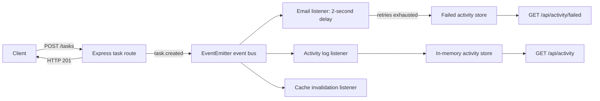

# Practical 10: Asynchronous Processing with Event-Driven Architecture

## Aim

Use Node.js's built-in `EventEmitter` to process task notifications, activity logging, and cache invalidation independently of the HTTP response.

## Theory

An event-driven architecture lets a route publish an event without directly coordinating every follow-up action. The task route emits a named event and responds immediately. Independent listeners handle the email simulation, activity log, and cache invalidation.

Each listener retries a failed operation three times after the initial attempt. If all four attempts fail, the failure is stored in memory and is available from the failed-activity endpoint. The email listener waits two seconds to make the asynchronous work observable.

## Folder structure

```text
task-manager-api/
├── events/
│   ├── activityStore.js
│   ├── eventBus.js
│   └── listeners/
│       ├── activityLogListener.js
│       ├── cacheListener.js
│       └── emailListener.js
├── docs/
│   └── practical-10.md
├── cache.js
├── server.js
└── test-events.js
```

## How to run

From `task-manager-api`, start the API:

```bash
npm start
```

In a second terminal, run the event timing demo:

```bash
node test-events.js
```

The demo uses `http://localhost:5000` by default. Set `API_URL` to use another server URL. To demonstrate listener retries and failed-activity recording, stop the server, set `DEMO_EMAIL_FAILURE=true`, and start it again. Email processing will fail after four attempts; view the recorded failures at `GET /api/activity/failed`.

The activity endpoints are `GET /api/activity` and `GET /api/activity/failed`. Task endpoints remain `GET/POST /tasks`, `GET/PUT/DELETE /tasks/:id`.

## Sample output

```text
Request started: 2026-10-19T14:45:00.000Z
API responded:   2026-10-19T14:45:00.030Z (HTTP task 101)
Email finished:  2026-10-19T14:45:02.035Z
```

Timestamps and task IDs vary. The API response is printed before the fake email completes.

## Event flow



## Conclusion

Task side effects are separated into event listeners, so the API can return without waiting for the simulated email. Failed listeners are retried and exposed for inspection, and task changes invalidate cached data through the cache listener.

## Viva Q&A

1. **What is event-driven architecture?**  
   An approach where components communicate by publishing and handling events rather than calling each other directly.

2. **What is Node.js `EventEmitter` used for here?**  
   It publishes task events to independent listeners in the same Node.js process.

3. **Why does the API respond before the email finishes?**  
   The route emits the event and returns its HTTP response without awaiting the listener's two-second email simulation.

4. **How many times can a listener attempt an operation?**  
   Four times total: the initial attempt plus three retries.

5. **Why is the cache invalidated after a task changes?**  
   To prevent later reads from returning task data cached before the write.
```
