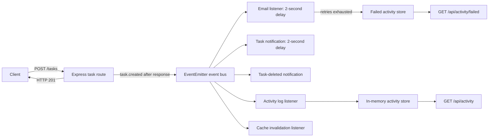

# Practical 10: Asynchronous Processing with Event-Driven Architecture

## Aim

Use Node.js's built-in `EventEmitter` to process task notifications, activity logging, and cache invalidation outside the HTTP response path.

## Theory

An event-driven architecture lets a route publish an event without directly coordinating every follow-up action. The task route sends the `201` response, logs its timestamp, then emits `task.created`. Independent listeners handle the delayed notification, email simulation, activity log, and cache invalidation. The notification reports the task title, timestamp, and assigned user (`Unassigned` when none is provided). The `task.deleted` event has its own notification listener.

`EventEmitter.emit()` invokes its listeners synchronously; it does not make listener code asynchronous by itself. The notification listener schedules its work with `setTimeout`, returns without waiting, and completes two seconds later. Other listeners do small synchronous work. Listener failures are retried three times after the initial attempt; after four total attempts, an `error` event logs the failure and it is stored for the failed-activity endpoint.

This practical's Task Manager API uses an in-memory task array rather than MongoDB. The event flow applies to its current storage implementation.

## Folder structure

```text
task-manager-api/
├── events/
│   ├── activityStore.js
│   ├── eventBus.js
│   └── listeners/
│       ├── activityLogListener.js
│       ├── cacheListener.js
│       └── emailListener.js
│       └── taskNotificationListener.js
├── docs/
│   └── practical-10.md
├── cache.js
├── server.js
└── test-events.js
```

## How to run

From `task-manager-api`, start the API:

```bash
npm start
```

In a second terminal, run the event timing demo:

```bash
node test-events.js
```

The demo uses `http://localhost:5000` by default. Set `API_URL` to use another server URL. The notification runs two seconds after the response. Include `assignedUser` in a `POST /tasks` JSON body to show an assignee in the notification; if omitted, it logs `Unassigned`. To demonstrate listener retries and failed-activity recording, stop the server, set `DEMO_EMAIL_FAILURE=true`, and start it again. Email processing will fail after four attempts; view the recorded failures at `GET /api/activity/failed`.

The activity endpoints are `GET /api/activity` and `GET /api/activity/failed`. Task endpoints remain `GET/POST /tasks`, `GET/PUT/DELETE /tasks/:id`.

## Sample output

```text
Request started: 2026-10-19T14:45:00.000Z
API responded:   2026-10-19T14:45:00.030Z (HTTP task 101)
[API] POST /tasks response sent at 2026-10-19T14:45:00.029Z
[Notification] task-created handler started at 2026-10-19T14:45:00.030Z
[Notification] Task "Event demo 123" created at 2026-10-19T14:45:02.030Z; assigned user: Unassigned
Email finished:  2026-10-19T14:45:02.031Z
```

Timestamps and task IDs vary. The server's response log appears before the notification handler starts, and the notification completion appears about two seconds later. The `API responded` line is printed by the demo client after it receives the response.

## Event flow



## Conclusion

Task side effects are separated into event listeners, so the API sends its response before the delayed notification and email work complete. Failed listeners are retried and exposed for inspection, and task changes invalidate cached data through the cache listener.

## Viva Q&A

1. **What is event-driven architecture?**  
   An approach where components communicate by publishing and handling events rather than calling each other directly.

2. **Does `emit()` make event handling asynchronous?**
   No. `emit()` calls listeners synchronously. Here the route sends its response before emitting, and delayed notification work uses `setTimeout`; the event loop runs that work later without holding the request open.

3. **What if notification work ran directly inside the POST route?**
   The route would wait for that work before sending its response, increasing response time by the notification delay.

4. **How many times can a listener attempt an operation?**  
   Four times total: the initial attempt plus three retries.

5. **Why is the cache invalidated after a task changes?**  
   To prevent later reads from returning task data cached before the write.

6. **Why is `EventEmitter` suitable here but not for millions of production events?**
   It is built in, simple, and useful for lightweight in-process work. Events are not durable or shared across processes, and work can be lost if the process stops; high-volume production workloads generally need a durable message broker and independent workers.

## Evidence

Run `node test-events.js` while the API is running and capture the terminal output showing the API response before the notification completion. Save the genuine screenshot or recording in the lab journal; do not use the illustrative timestamps above as evidence.
```
